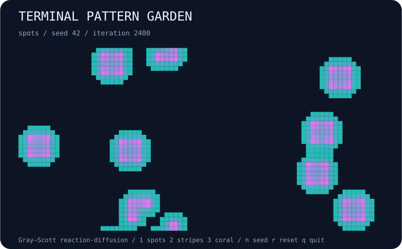

# terminal-pattern-garden

Grow spots, stripes, and coral with a seeded Gray–Scott reaction-diffusion model.



## Run

```bash
npx --yes github:b69ca/terminal-pattern-garden
```

Node.js 20 or newer. No runtime dependencies. Everything runs locally.

## Play

| Key | Action |
| --- | --- |
| `p` / Space | Pause or resume |
| `.` | Pause and advance one step |
| `n` | Start the next seed |
| `r` | Reset the current seed |
| `+` / `-` | Faster or slower display |
| `q` / Ctrl-C | Quit and restore the terminal |

`--preset spots|stripes|coral` selects a pattern recipe. Keys `1`, `2`, `3` reset to the selected recipe. One live tick advances 12 iterations; `.` advances exactly one.

Live mode uses an alternate screen and restores the cursor and input mode on exit. `--no-color` or `NO_COLOR=1` disables ANSI colors. The live grid fits the terminal at startup; explicit sizes make runs reproducible across terminals. Very small terminals may clip the minimum grid.

## Export

```bash
npx --yes github:b69ca/terminal-pattern-garden --seed 42 --steps 2400 --svg preview.svg
npx --yes github:b69ca/terminal-pattern-garden --seed 42 --steps 2400 --json
npx --yes github:b69ca/terminal-pattern-garden --frames 100
```

Common flags: `--seed N` (0–4294967295), `--width N` (20–120), `--height N` (10–60), `--steps N` (0–10000), `--frames N` (0–100000), `--json`, `--svg FILE`, `--no-color`, and `--help`.

Live mode begins at step zero; exports and piped output default to 2400 steps. `--steps 0` shows the initial state. JSON and SVG may be combined; neither accepts `--frames`. Piped terminal output shows at most one plain frame without escape sequences. Live frames show the starting state first, advance between frames, and count paused frames toward the limit. Exit codes: 0 success, 2 argument or file error.

## How it works

A pair of chemicals diffuses across a periodic grid and reacts through the Gray–Scott equations. Nine seeded patches begin with U = 0.5 and V around 0.25 in a background of U = 1, V = 0. A synchronous Euler update uses diffusion rates 0.16 and 0.08, time step 1, and a nine-point Laplacian (center −1, axial 0.2, diagonal 0.05). Concentrations are clamped to [0,1]. Preset feed/kill pairs are spots 0.0367/0.0649, stripes 0.03/0.062, and coral 0.0545/0.062. Names describe tendencies; finite grid size and seed affect the resulting pattern. This is a numerical art toy, not a calibrated chemical simulation. JSON summarizes concentration V; it does not export the full field.

## Library

Install with `npm install github:b69ca/terminal-pattern-garden`, then:

```js
import { createWorld, step, analyze, renderSVG } from 'terminal-pattern-garden';
const world = createWorld({ seed: 42, width: 80, height: 40 });
step(world, 2400); // Mutates and returns world.
console.log(analyze(world));
const svg = renderSVG(world);
```

Renderers and `step` accept worlds returned by `createWorld`. Keep the returned state intact. Changing dimensions or internal arrays after construction is unsupported.

## Development

```bash
npm ci
npm run check
```

Tests cover deterministic seeds, incremental updates, model invariants, bounds, render dimensions, CLI errors, and exports. GitHub Actions runs Node.js 20, 22, and 24.

## License

MIT
